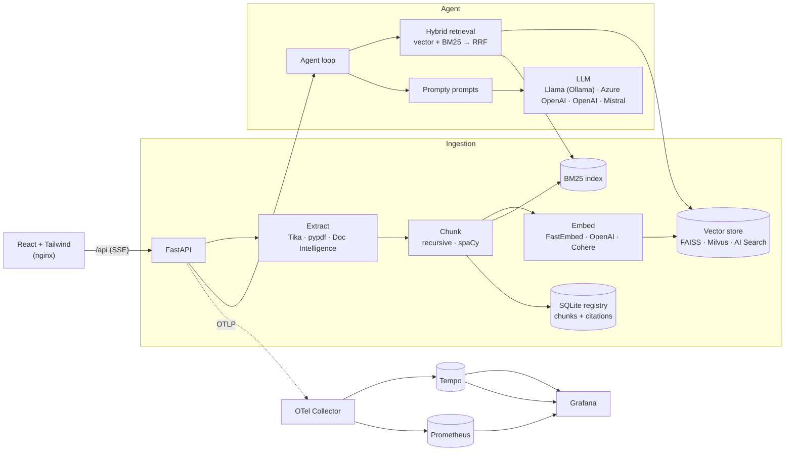
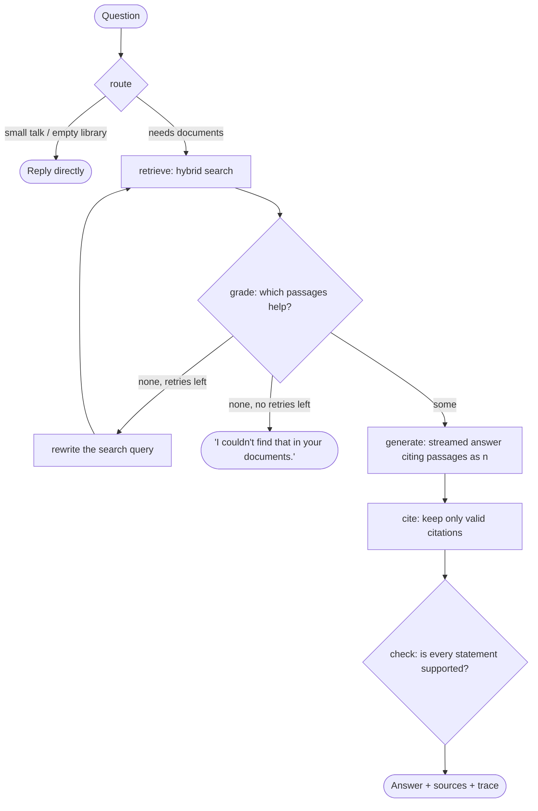

# Askwise: agentic RAG over your documents

[](https://github.com/sahilmaddi/askwise-agentic-rag/actions/workflows/ci.yml)


Askwise answers questions about your documents, with a citation for every fact. Upload PDFs, Word files, slides or Markdown; an agent searches them, throws away passages that don't help, retries with a better query when nothing fits, writes an answer that cites its sources and then checks that answer against those sources. If the answer isn't in your documents, it says so instead of guessing.

It is a full-stack implementation of the agentic AI reference stack: every layer (ingestion, chunking, embeddings, vector database, retrieval, prompts, LLM, infrastructure, observability) is a pluggable component with open-source and Azure options.

## The stack, layer by layer

| Layer | Used here | Switch with |
| --- | --- | --- |
| Frontend | React 19 + Tailwind CSS 4 (Vite), live agent trace over server-sent events | |
| Document ingestion | Apache Tika (Word, PowerPoint, HTML, OCR for scans), pypdf, Azure AI Document Intelligence | `TIKA_URL`, `AZURE_DOCINTEL_*` |
| Chunking | Recursive splitter (LangChain's algorithm) or sentence-aware splitter (spaCy) | `CHUNKER=recursive\|sentence` |
| Embeddings | Hugging Face `bge-small-en-v1.5` via FastEmbed (local), OpenAI, Azure OpenAI, Cohere | `EMBEDDINGS_PROVIDER` |
| Vector database | FAISS, Milvus / Milvus Lite, Azure AI Search, in-memory NumPy | `VECTOR_STORE` |
| Retrieval | Hybrid: vector search + BM25, merged with Reciprocal Rank Fusion (as Azure AI Search does) | |
| Prompt engineering | Prompty files (`.prompty`): versioned prompts with model settings and sample inputs | edit `backend/app/prompts/` |
| LLM | Meta Llama 3.2 via Ollama (local), OpenAI, Azure OpenAI, Mistral, all through LangChain | `LLM_PROVIDER`, `LLM_MODEL` |
| Infrastructure | Docker Compose, Kubernetes (Kustomize), Terraform for Azure Container Apps | `infra/` |
| Observability | OpenTelemetry traces and metrics → Tempo, Prometheus, Grafana; or Azure Monitor / AI Foundry | `OTEL_*`, `APPLICATIONINSIGHTS_CONNECTION_STRING` |

With no settings at all it runs fully offline (an extractive answerer and hashing embeddings), which is also how the tests run.

## Architecture



### The agent loop



Every node is timed, traced as an OpenTelemetry span and streamed to the browser, so you can watch the agent work and see exactly which step was slow.

## Run it

**Docker Compose** (app, API, Tika, Ollama with Llama 3.2, OpenTelemetry Collector, Tempo, Prometheus, Grafana):

```bash
cp .env.example .env            # optional: pick providers and add keys
docker compose up --build
```

| URL | What |
| --- | --- |
| http://localhost:3000 | Askwise |
| http://localhost:3000/api/docs | API reference (OpenAPI) |
| http://localhost:3001 | Grafana, with the Askwise dashboard and traces |

Three sample policy documents for a fictional company are loaded on start, so you can ask straight away, e.g. *"How many days of annual leave do full-time employees get?"* or *"vacation?"* (which shows the rewrite step).

The first start downloads Llama 3.2 1B (about 1.3 GB). For a start without any model download:

```bash
LLM_PROVIDER=extractive EMBEDDINGS_PROVIDER=hashing docker compose up --build
```

To use Azure OpenAI instead: `LLM_PROVIDER=azure`, `EMBEDDINGS_PROVIDER=azure`, deployment names in `LLM_MODEL` / `EMBEDDINGS_MODEL`, and `AZURE_OPENAI_ENDPOINT`, `AZURE_OPENAI_API_KEY` in `.env`.

**Without Docker:**

```bash
cd backend && pip install -r requirements.txt && SEED_SAMPLES=true uvicorn app.main:app --reload
cd frontend && npm install && npm run dev        # http://localhost:5173
```

## API

| Method | Path | |
| --- | --- | --- |
| GET | `/api/info` | Active providers, document and chunk counts, accepted file types |
| GET, POST | `/api/documents` | List, or upload one or more files (`multipart/form-data`, field `files`). Identical content is detected by SHA-256 |
| DELETE | `/api/documents/{id}` | Remove a document from every index |
| POST | `/api/ask` | `{"question": "...", "top_k": 5}` → answer, citations, steps, grounded flag |
| POST | `/api/ask/stream` | Same, as server-sent events: `step` events as the agent works, `token` events as the answer is written, then `done` |

## Design decisions

- **The agent may refuse.** If grading finds nothing relevant after the allowed rewrites, the answer is "I couldn't find that in your documents." No passages means no generation, so there is nothing to hallucinate from.
- **Hybrid retrieval.** Embeddings find paraphrases; BM25 finds exact terms such as policy names, codes and amounts. Reciprocal Rank Fusion merges both rankings without having to calibrate their scores against each other.
- **Grade before generating.** Retrieval always returns *something*. A grading step (one LLM call for all passages, JSON verdict) filters it, and an unreadable verdict keeps the passages rather than silently dropping them.
- **Citations are verified.** The answer must cite passages as `[n]`; citations that point at passages that don't exist are removed, and a groundedness check flags answers whose statements the passages don't support. The UI shows a warning when that happens.
- **Prompts are files.** The `.prompty` files hold the template, model parameters and a sample input. Tests render every prompt with its own sample, so a broken template fails CI.
- **Indexes per embedding model.** Vectors from different models can't be compared, so each model gets its own index directory, and the service re-embeds stored chunks automatically when you switch.
- **The SQLite registry is the source of truth** for chunk text and citations; vector stores only hold ids and vectors. Swapping FAISS for Milvus or Azure AI Search changes nothing else.
- **Offline mode is real code, not a mock.** The extractive "brain" makes the same decisions (grade, rewrite, answer, check) with text heuristics, so the whole pipeline is tested end to end in CI without API keys or model downloads.

## Observability

With `OTEL_EXPORTER_OTLP_ENDPOINT` set (Docker Compose does this), the API exports:

- **Traces:** one `agent.run` span per question with child spans for every step, plus `ingest.extract`, `ingest.chunk` and `ingest.embed` for uploads, and FastAPI request spans.
- **Metrics:** `askwise.questions` (by outcome), `askwise.question.duration`, `askwise.agent.step.duration` (by step), `askwise.agent.rewrites`, `askwise.ingest.chunks`.

Grafana is provisioned with Prometheus and Tempo data sources and an Askwise dashboard (questions per minute, p50/p95 answer latency, p95 per agent step, recent traces). On Azure, `APPLICATIONINSIGHTS_CONNECTION_STRING` sends the same telemetry to Application Insights, which Azure AI Foundry uses for tracing.

## Deploy

**Kubernetes:** `kubectl apply -k infra/k8s` creates the namespace, config, API (with a persistent volume for the index), web (with an autoscaler), Tika and an ingress. Put provider keys in an `askwise-secrets` secret (see `configmap.yaml`).

**Azure Container Apps with Terraform:**

```bash
cd infra/terraform
cp terraform.tfvars.example terraform.tfvars   # images and Azure OpenAI endpoint/key
terraform init && terraform apply
```

This creates a resource group, Log Analytics, Application Insights, a Container Apps environment, an Azure Files share for the index, the API (internal ingress) and the web app (public ingress). Set `enable_ai_search = true` to create Azure AI Search and use it as the vector store, which also lets the API scale beyond one replica.

## Tests

```bash
cd backend && pytest
```

The suite covers chunking (size limits, overlap, sentence boundaries), BM25, rank fusion, the vector stores (persistence, deletes, FAISS when installed), every Prompty file, the agent (citations, streaming order, query rewriting, refusals, small talk, an LLM brain driven by a fake model including malformed JSON), the service (duplicates, unsupported files, restart, switching embedding models) and the HTTP API including the event stream. CI also lints with Ruff, builds the front end, runs `terraform validate`, renders the Kubernetes manifests and validates the Compose file.

## Project layout

```
askwise/
├── backend/
│   ├── app/
│   │   ├── ingestion/      extract (Tika, pypdf, Document Intelligence) and chunking
│   │   ├── vectorstores/   memory, FAISS, Milvus, Azure AI Search
│   │   ├── retrieval/      BM25 and hybrid retrieval with RRF
│   │   ├── prompts/        .prompty files and loader
│   │   ├── agent/          agent loop and its LLM / extractive "brains"
│   │   ├── embeddings.py   llm.py   telemetry.py   service.py   main.py
│   ├── samples/            demo documents
│   └── tests/
├── frontend/               React + Tailwind CSS chat, library and agent trace
├── infra/
│   ├── k8s/                Kustomize manifests
│   ├── terraform/          Azure Container Apps
│   └── observability/      OTel Collector, Tempo, Prometheus, Grafana provisioning
└── docker-compose.yml
```
